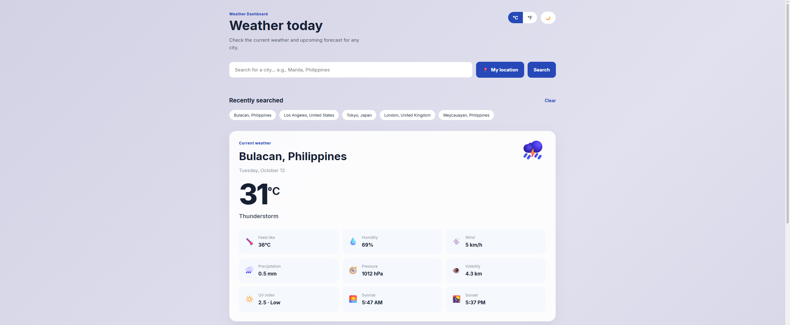
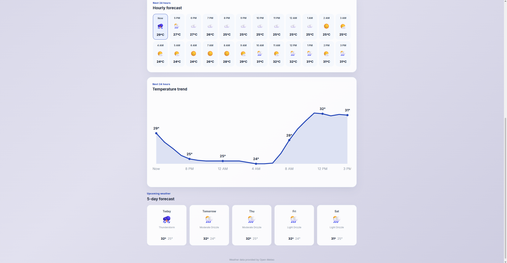
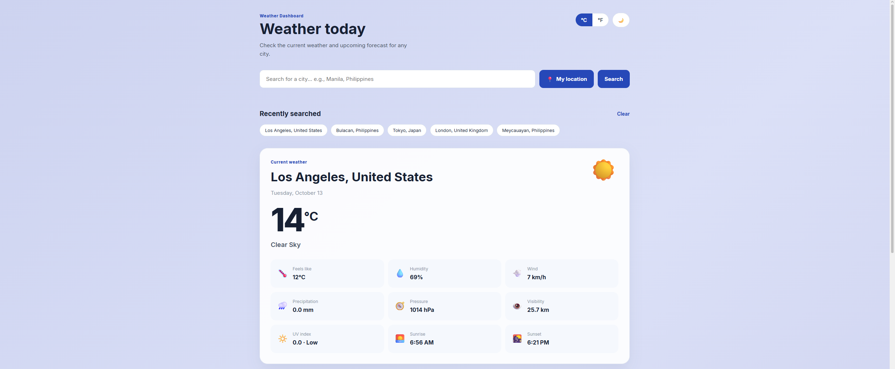
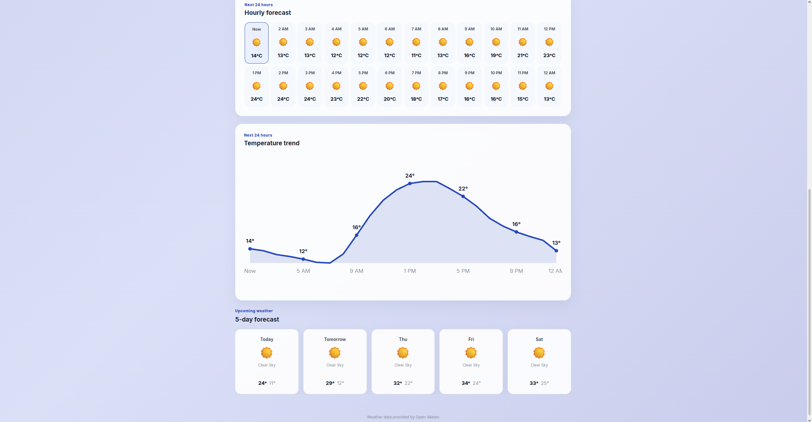
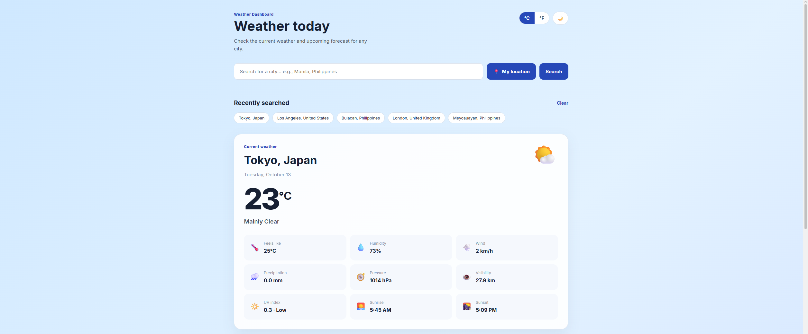
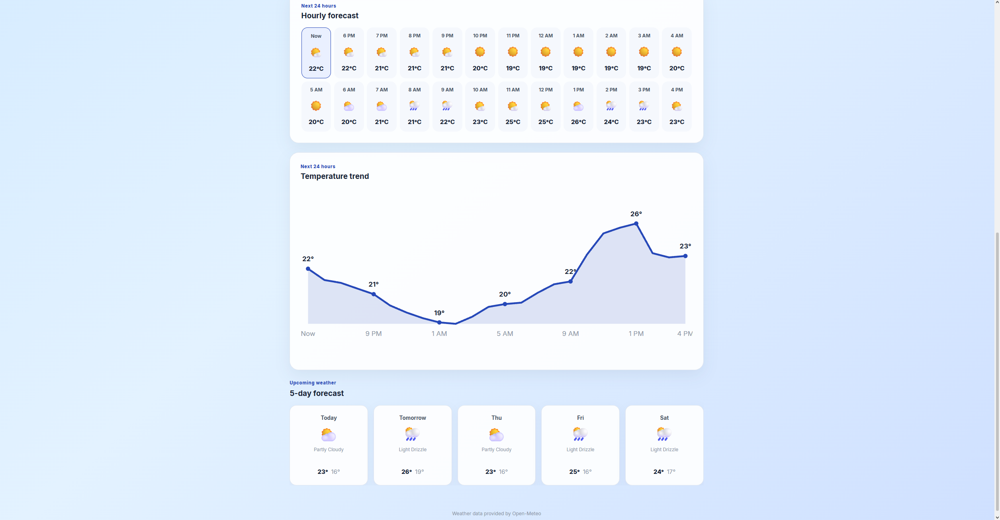

# Weather Dashboard

A responsive, installable weather dashboard built with **HTML, CSS, and vanilla JavaScript**. Search any city to see current conditions, the next 24 hours, a temperature chart, and a 5-day forecast. It works without a build step, a backend, or an API key.



---

## Table of Contents

- [Features](#features)
- [Tech Stack](#tech-stack)
- [Getting Started](#getting-started)
- [Usage](#usage)
- [How It Works](#how-it-works)
- [Data Sources](#data-sources)
- [Project Structure](#project-structure)
- [Browser Storage](#browser-storage)
- [Accessibility](#accessibility)
- [Offline and PWA Support](#offline-and-pwa-support)
- [Browser Support](#browser-support)
- [Credits](#credits)
- [License](#license)
- [Author](#author)

---

## Features

### Search and suggestions

- Search for any city by name. Typing two or more characters shows up to five matching cities with their region and country.
- Suggestions are fetched with a 250 ms debounce, and any in-flight request is cancelled (`AbortController`) when a newer one starts.
- Keyboard support follows the accessible combobox pattern: **↑/↓** to move, **Enter** to select, **Esc** to close.
- **My location** uses the browser's geolocation. Coordinates are converted to a city name, or the result is labelled "Current Location" if no name can be found.

### Current conditions

- Temperature, with a **°C / °F** toggle that re-renders from the loaded data without another API call.
- A condition label and icon (for example, ☀️ Clear Sky or ⛈️ Thunderstorm), translated from Open-Meteo weather codes.
- Feels-like temperature, humidity, wind speed, precipitation, pressure, visibility, UV index (with a Low / Moderate / High / Very High / Extreme label), sunrise, and sunset.

### Hourly forecast and chart

- A horizontally scrollable row of the next 24 hours. The current hour is labelled **Now** and highlighted.
- A temperature trend chart for the same 24-hour window. It is plain inline SVG, so no charting library is needed. A text summary is provided for screen readers.

### 5-day forecast

- Day, icon, condition, and high/low temperatures for the next five days.
- The grid adjusts its column count to the screen width.

### Recent searches

- The last five successful searches appear as buttons. Click one to reload its weather.
- **Clear** removes the history.
- On a return visit, the most recent city loads automatically. On a first visit, Manila is shown.

### Personalization

- **Dark mode:** a header toggle switches between light and dark themes. The choice is saved, and if none is saved yet the app follows the OS `prefers-color-scheme` setting.
- **Weather-based backgrounds:** the page tint changes with the current conditions and day or night (for example, clear-day sky blue, clear-night indigo, rain blue-grey, thunder muted violet-grey).

### Works offline

- The app shell is cached by a service worker, so it still opens without a connection.
- The last successful weather response is saved. If a later request fails while offline, that saved weather is shown with a banner that says when it was saved.
- The app can be installed to the home screen or dock where the browser supports it.

### Screenshots

Each city has two screenshots: the top of the page (current conditions) and the lower half (hourly forecast, temperature trend, and 5-day forecast).

**Bulacan, Philippines**, during a thunderstorm at 31°C




**Los Angeles, United States**, clear sky at 14°C




**Tokyo, Japan**, mainly clear at 23°C




---

## Tech Stack

| Layer | What is used |
| --- | --- |
| Markup | Semantic HTML5, ARIA combobox and live-region patterns |
| Styling | CSS custom properties, Grid and Flexbox, media queries, `prefers-reduced-motion` |
| Logic | Vanilla JavaScript (ES2017+): `async`/`await`, `fetch`, `AbortController`, template literals |
| Storage | `localStorage` |
| PWA | Web App Manifest, Service Worker, `beforeinstallprompt` |
| Data | [Open-Meteo](https://open-meteo.com/) (forecast and geocoding), [BigDataCloud](https://www.bigdatacloud.com/) (reverse geocoding) |

There are no frameworks, bundlers, or npm dependencies.

---

## Getting Started

### Prerequisites

- A modern browser (see [Browser Support](#browser-support))
- An internet connection for live weather data
- Optional: a local static server, such as the VS Code **Live Server** extension

No API key or backend is required.

### Clone the repository

```bash
git clone https://github.com/bmarkjan-stack/p3-weather-dashboard.git
cd p3-weather-dashboard
```

### Run it

You can open `index.html` directly, but a local server is recommended. The service worker and geolocation features only work on `http://localhost` or HTTPS, not on `file://`.

**Option A: VS Code Live Server**

1. Open the folder in VS Code.
2. Install the **Live Server** extension if you do not have it.
3. Right-click `index.html` and choose **Open with Live Server**.

**Option B: Python**

```bash
python3 -m http.server 8080
```

Then open http://localhost:8080.

**Option C: Node**

```bash
npx serve .
```

---

## Usage

1. **Search:** type a city, optionally with a country (for example, `Manila, Philippines`), then press **Search** or **Enter**. Pick a suggestion with the arrow keys or the mouse.
2. **Use your location:** press **My location** and allow the browser prompt.
3. **Switch units:** press **°C** or **°F** in the header.
4. **Switch theme:** press the moon or sun icon in the header.
5. **Revisit a city:** press a button under **Recently searched**.
6. **Clear history:** press **Clear** next to **Recently searched**.

---

## How It Works

A search runs as a short pipeline:

```text
City name ──► Geocoding API ──► latitude / longitude ──► Forecast API ──► render ──► save
```

1. **Geocode.** `searchCity()` calls the Open-Meteo Geocoding API and takes the first result.
2. **Fetch weather.** `getWeather()` requests current, hourly, and daily variables for those coordinates.
3. **Render.** `renderWeather()` fills the current-conditions card, then calls `displayHourly()`, `renderChart()`, and `displayForecast()`.
4. **Save.** On success, the city is added to the recent list and the response is cached for offline use.

All of this runs through one shared function, `loadWeatherForLocation()`. Search submit, suggestion selection, recent-city clicks, geolocation, and the default city load all use it, so loading, error, and offline handling is consistent.

### Loading and errors

- `showLoading()` shows the spinner, hides the dashboard, and disables the search and location buttons.
- Errors are shown in an inline `role="alert"` message. Examples include an empty search, a city that cannot be found, a failed request, or denied location access.
- If the request fails because the browser is offline, the app falls back to the saved weather when there is any.

---

## Data Sources

### Open-Meteo Geocoding API

Turns a city name into coordinates.

```text
https://geocoding-api.open-meteo.com/v1/search?name=Manila&count=1
```

### Open-Meteo Forecast API

Requested variables:

- **Current:** `temperature_2m`, `relative_humidity_2m`, `apparent_temperature`, `is_day`, `precipitation`, `pressure_msl`, `weather_code`, `wind_speed_10m`
- **Hourly:** `temperature_2m`, `weather_code`, `uv_index`, `visibility`
- **Daily (6 days):** `weather_code`, `temperature_2m_max`, `temperature_2m_min`, `sunrise`, `sunset`, `uv_index_max`

The request uses `timezone=auto`, so times are shown in the searched city's local time. The API is asked for six days so the 24-hour window is complete even late in the day. Only five days are displayed.

### BigDataCloud reverse geocoding

Used only by **My location** to convert GPS coordinates into a city and country name. It is a free, keyless, client-side endpoint.

### Weather codes

Open-Meteo returns WMO weather codes. `getWeatherInfo()` in `script.js` maps each code to a label, an emoji, and a background group. A few examples:

| Code | Condition | Icon |
| ---: | --- | --- |
| 0 | Clear Sky | ☀️ |
| 1 | Mainly Clear | 🌤️ |
| 2 | Partly Cloudy | ⛅ |
| 3 | Overcast | ☁️ |
| 45 | Fog | 🌫️ |
| 61 | Slight Rain | 🌦️ |
| 63 | Moderate Rain | 🌧️ |
| 75 | Heavy Snow | ❄️ |
| 82 | Violent Rain Showers | ⛈️ |
| 95 | Thunderstorm | ⛈️ |

The full table covers every code Open-Meteo documents for these variables. Unknown codes fall back to "Unknown" with a thermometer icon.

---

## Project Structure

```text
p3-weather-dashboard/
├── index.html             Page structure, ARIA labels, and the skip link
├── styles.css             Layout, theme tokens, weather backgrounds, responsive rules
├── script.js              API calls, rendering, suggestions, storage, geolocation, PWA hooks
├── sw.js                  Service worker: app-shell cache and offline fallback
├── manifest.webmanifest   Name, icons, colors, and display mode for installation
├── icons/                 Favicon, Apple touch icon, and 192/512 px regular and maskable icons
├── images/                Screenshots used in this README
└── README.md
```

### `index.html`

Contains the header with unit and theme controls, the search form with the suggestions list, the recent-cities section, the loading indicator, the offline banner, and the weather sections. A screen-reader-only live region announces status changes.

### `script.js`

Organized into sections marked with comment headers:

- Configuration: API URLs, storage keys, limits
- DOM references
- Weather code mapping
- Units and theme
- Search, suggestions, and reverse geocoding
- Weather request and rendering (current, hourly, chart, daily)
- Recent-city and last-weather storage
- Form, clear, geolocation, and install handlers
- Service worker registration and initial page load

### `styles.css`

Defines colors as custom properties on `:root`, with a dark palette under `[data-theme="dark"]` and background tints under `[data-weather]`. Responsive breakpoints are at 800 px, 600 px, and 400 px. The stylesheet also respects `prefers-reduced-motion`.

### `sw.js`

- **Install:** pre-caches the app shell (HTML, CSS, JS, manifest, and icons).
- **Activate:** deletes older shell caches.
- **Fetch:** page navigations use network-first with a cached fallback. Other same-origin GET requests use stale-while-revalidate. Cross-origin API calls are not intercepted.

When you change any shell file, bump `VERSION` in `sw.js` so returning users receive the new files.

---

## Browser Storage

All keys use the `weatherDashboard` prefix.

| Key | Contents | Purpose |
| --- | --- | --- |
| `weatherDashboardRecentCities` | Array of up to 5 `{ name, country, latitude, longitude }` | Recent-search buttons |
| `weatherDashboardUnit` | `"C"` or `"F"` | Temperature unit |
| `weatherDashboardTheme` | `"light"` or `"dark"` | Theme choice. If unset, the OS preference is used. |
| `weatherDashboardLastWeather` | `{ location, weatherData, savedAt }` | Offline fallback |

Every read and write is wrapped in `try/catch`. If storage is blocked, for example in some private-browsing modes, the app still works and logs the error to the console.

---

## Accessibility

- A skip link jumps past the header to the weather content.
- The city field is an ARIA combobox (`aria-expanded`, `aria-activedescendant`, `aria-controls`) with full keyboard support.
- A visually hidden `aria-live` region announces loading, success, offline, and location states. Errors use a separate `role="alert"` element.
- Icon-only buttons have `aria-label`s. Toggle buttons expose `aria-pressed`.
- Focus outlines are visible throughout.
- Text and background colors, including each weather-based background in both themes, were checked against WCAG AA contrast.
- Animations are shortened when `prefers-reduced-motion` is set.

---

## Offline and PWA Support

- **Installable:** the manifest provides regular and maskable icons. An **Install** button appears when the browser fires `beforeinstallprompt`.
- **App shell cache:** the interface loads offline after the first visit.
- **Last-weather fallback:** if a request fails offline, the saved weather is shown with a banner, instead of only an error message.
- **Online and offline events:** the banner is hidden when the connection returns.

Weather data is never cached by the service worker. Freshness is controlled by the app's own saved copy.

---

## Browser Support

Any current version of Chrome, Edge, Firefox, Safari, or their mobile equivalents should work. The app uses modern features, including `async`/`await`, `AbortController`, CSS custom properties, and the Geolocation API. Internet Explorer is not supported.

---

## Known Limitations

- Weather is shown in Celsius or Fahrenheit only. Wind speed is always km/h, and precipitation is always mm.
- The search returns the top geocoding match. To pick a different city with the same name, type the country or region after the city name.
- Geolocation and the install prompt require a secure context (`https://` or `localhost`).
- The service worker caches shell files only. Weather data is available offline only from the single most recent successful request.

---

## Credits

- Weather and geocoding data: **[Open-Meteo](https://open-meteo.com/)** (no API key required)
- Reverse geocoding: **[BigDataCloud](https://www.bigdatacloud.com/)** (free client-side endpoint)

---

## License

This project is licensed under the [MIT License](LICENSE). You are free to use, copy, modify, merge, publish, distribute, and sell the code, provided the copyright and license notice are included in copies or substantial portions of it.

---

## Author

**Mark Jan Bautista**, aspiring web developer

- GitHub: https://github.com/bmarkjan-stack
- Repository: https://github.com/bmarkjan-stack/p3-weather-dashboard